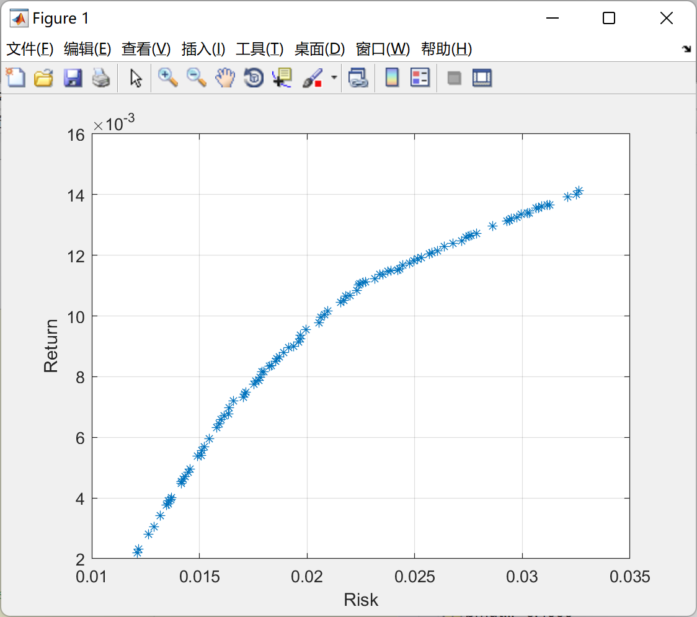

# Combinatorial Optimization Based on SPEA2 Multi-Objective Optimization Algorithm (Matlab Code Implementation)

Combinatorial Optimization Based on SPEA2 Multi-Objective Optimization Algorithm (Matlab Code Implementation)
SPEA2 Algorithm Principles and Application Directions

## Images

<!-- PAYMENT_BLOCK -->

## Get this dataset

- Payment link (Stripe): [Buy now](https://buy.stripe.com/3cs8yP7sY87d0vu9AB)
- Payment QR code: 

<!-- /PAYMENT_BLOCK -->
